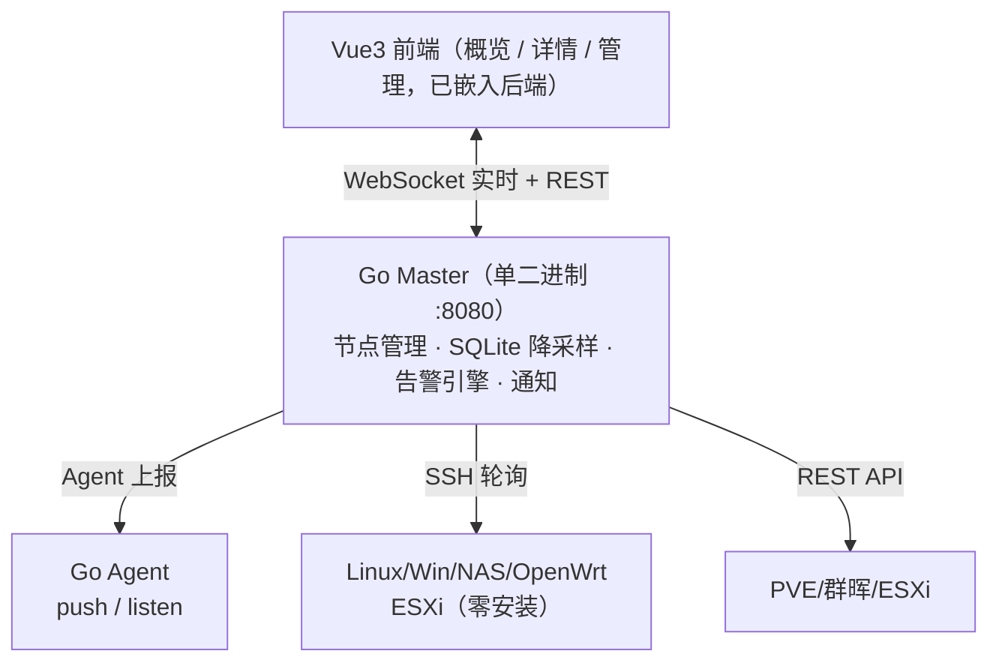

# CC_DashBoard

轻量级、跨平台的**服务器与设备状态集中监控平台**：一个面板同时监控 Linux / Windows / NAS / 路由器 / 虚拟化宿主机，实时指标、历史趋势、阈值告警、消息推送。

- 后端 Go 单二进制（内嵌 Vue3 前端，**一个文件跑起全套**）
- 采集端一个 Go Agent 覆盖全平台；不便安装的目标机走 SSH / 原生 API
- SQLite 嵌入式存储，5 秒 → 1 分钟 → 1 小时三级降采样，支撑一年历史

## 特性

| 能力 | 说明 |
|---|---|
| 实时概览 | 响应式设备卡片：在线/告警/离线状态灯、CPU/内存/磁盘进度条、网速、运行时长；类型/状态筛选与搜索；WebSocket 实时推送 |
| 设备详情 | 当前实时区（每核 CPU、内存细分、分网卡吞吐、温度、进程 Top5、磁盘 I/O）+ 历史图表 `1小时 / 24小时 / 7天 / 30天 / 半年 / 一年` + 硬件详情弹窗 |
| 三种接入 | **A. Agent 上报**（反向推送 / 正向拉取，创建时二选一）· **B. SSH 轮询**（目标机零安装，长连接复用 + TOFU 主机指纹）· **C. 原生 API**（PVE / 群晖 DSM / ESXi 专属适配） |
| 目标系统 | Ubuntu/Debian/CentOS 等 Linux、Windows、飞牛/群晖/威联通/TrueNAS NAS、**OpenWrt 软路由**、macOS、**Proxmox VE**（含虚机/容器汇总）、**VMware ESXi**（真机校准）、树莓派 |
| 安全 | 后台强制密码 / 前台可选密码、AES-256-GCM 凭据加密、节点 Token 鉴权（支持后台一键轮换）、Join Key 自注册 + 后台审批、SSH 主机指纹 TOFU（支持重置） |
| 告警 | 阈值规则（含**连续超阈值 N 分钟触发延时**，后台可编辑）、离线检测 + 上下线实时推送；通知渠道：pushplus / 飞书 / 钉钉 / 企业微信 / 通用 Webhook / **SMTP 邮件**，失败自动重试 3 次且发送记录落库 |
| 导出 | Prometheus `/metrics` 抓取端点；历史数据 CSV 导出（Excel 直开） |
| 网络与记录 | 节点地址**双行显示内网 / 公网 IP**（上报连接源 IP 为主、Agent 自查兜底）；开关机记录自动入库（按节点+时间+类型去重），详情页展示 |
| 程序池 / OTA | 管理页上传 Agent / Dashboard 程序到"池"，节点按版本与架构显示**可升级**提示；OTA 总开关默认关，开启后 Agent 自动升级（下载 sha256 校验、升级失败自动回滚；OpenWrt 仅提示不执行） |
| 交付 | `build.ps1` 一键产出 Win/Linux×2/树莓派 服务端 + 5 架构 Agent + ipk/deb/rpm（**服务端也有 deb/rpm**）；版本号构建时交互生成（记录于 `VERSION`，**统一三段式**，回车次版本 +1，`-Version` 指定主版本）注入二进制与安装包；安装包内置 systemd unit / OpenWrt init.d，**装完自动注册开机自启**；`--install` 交互式注册（sc / systemd / procd）；Windows exe 内嵌应用图标与版本信息，deb/rpm/ipk 包内自带应用图标 |

## 快速开始

```powershell
# 1. 构建（前端 + 嵌入 + 服务端/Agent 多平台 + 打包）
powershell -ExecutionPolicy Bypass -File build.ps1

# 2. 启动（单端口：API + 面板）
.\build\cc-dashboard-<版本>-windows-amd64.exe -addr :8080 -data data

# 3. 打开 http://127.0.0.1:8080/
#    首次进入「节点管理」会引导设置管理员密码
```

添加第一个节点：**节点管理 → 添加节点** → 选接入模式（推荐 Agent）→ 复制 Token → 目标机运行：

```bash
cc-agent -master http://<master>:8080 -token <Token> -interval 5s
# 或交互式安装为系统服务：
cc-agent --install
```

Linux / NAS / Windows / OpenWrt / ESXi 的分平台接入步骤见 **[使用部署手册](docs/使用部署手册.md)**。

## 架构



## 目录结构

```
├── server/            # Go 后端（api / store / collector / alert / notify / auth）
│   ├── deploy/        # Dockerfile、docker-compose.yml
│   └── internal/webui/dist/  # 构建时嵌入的前端产物（build.ps1 从 web/dist 同步）
├── web/               # Vue3 前端（Vite + Pinia + ECharts + Tailwind）
├── agent-go/          # Go Agent（唯一采集端，push 与 listen 双模式）
├── tools/mkipk/       # OpenWrt .ipk 打包工具（纯 Go，含 init.d/postinst 模板）
├── packaging/         # systemd unit、配置模板、应用图标与 Windows 版本资源（deb/rpm/ipk 包内文件）
├── intro-page/        # 项目介绍页（静态 HTML）与界面截图
├── docs/              # 接口契约 + 部署手册：API.md / APP-API.md / APP-DESIGN.md / 使用部署手册.md
├── .github/workflows/ # CI：构建与测试
├── build.md           # 构建产物选型说明
├── build.ps1          # 一键构建 + 打包（交互式版本号，产物进 build/）
├── VERSION            # 当前版本号（三段式，构建时生成/次版本递增，可手改）
├── nfpm-agent.yml     # Agent deb/rpm 打包模板（含 postinstall 自启）
└── nfpm-server.yml    # 服务端 deb/rpm 打包模板

> 构建产物全部在 `build/`（选型见 [build.md](build.md)），该目录与 `data/` 均不入库。
```

## 文档

| 文档 | 内容 |
|---|---|
| [docs/使用部署手册.md](docs/使用部署手册.md) | 部署、各平台接入、面板使用、升级与兼容性、故障排查 |
| [docs/API.md](docs/API.md) | REST / WebSocket 完整接口契约（前端与采集端对接） |
| [docs/APP-API.md](docs/APP-API.md) | 安卓 App 精简接口参考（Kotlin 数据模型、WebSocket 重连） |
| [docs/APP-DESIGN.md](docs/APP-DESIGN.md) | 安卓 App 产品与技术设计（页面结构、多面板、登录方案） |
| [build.md](build.md) | 构建产物选型：哪个文件用于哪个平台 |
| [intro-page/index.html](intro-page/index.html) | 项目介绍页（特性概览 + 界面截图） |

## 开发

```bash
# 后端
cd server && go vet ./... && go test ./... && go run ./cmd/master

# 前端（开发服务器，自带 /api 代理）
cd web && npm install && npm run dev   # http://127.0.0.1:5173

# 采集端
cd agent-go && go run . -master http://127.0.0.1:8080 -token <Token>
```

## License

[MIT](LICENSE) © 2026 milestone702

自由使用、修改、商用均可；分发本软件（含二进制与安装包）时须保留仓库中的 `LICENSE` 文件——其中的版权声明即开源署名信息。
